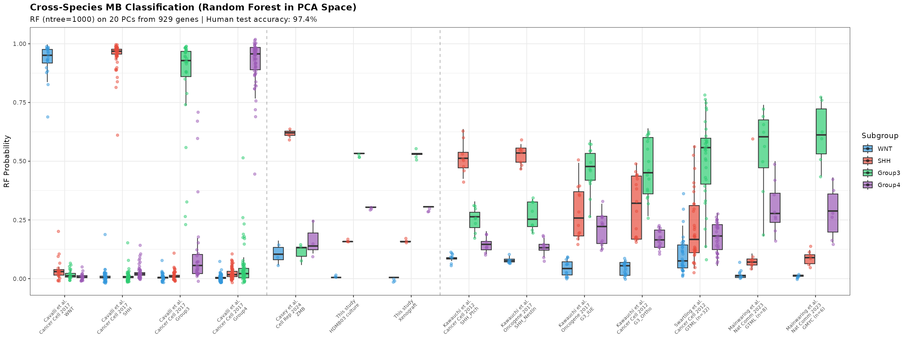
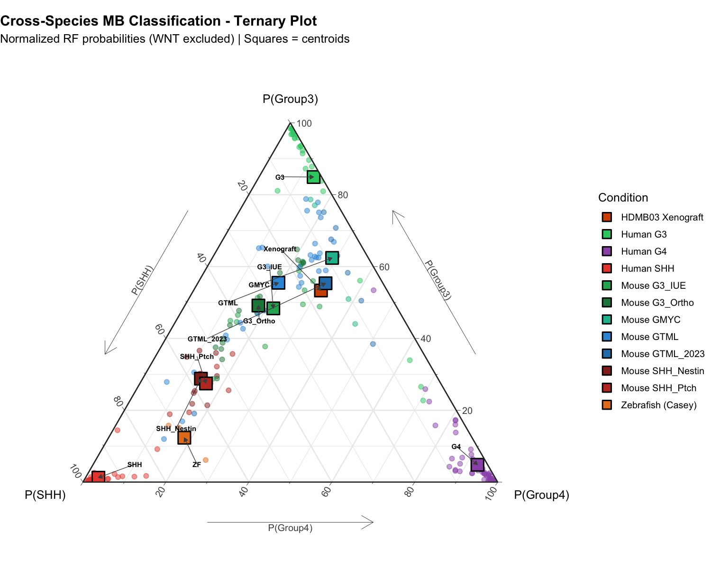

# Cross-Species Medulloblastoma Classification

This repository contains code and data to classify animal model medulloblastoma (MB) tumors by projecting them onto human MB subgroup reference space, reproducing and extending the approach from Casey et al. (Cell Reports 2024).

## Overview

We train a Random Forest classifier on human medulloblastoma samples (Cavalli et al., Cancer Cell 2017) using PCA coordinates, then project animal models (mouse, zebrafish, chicken xenografts) to classify them into one of four MB subgroups: WNT, SHH, Group3, or Group4.

## Datasets

| Dataset | Reference | Species | Platform | Content |
|---------|-----------|---------|----------|---------|
| **GSE85217** | Cavalli et al., 2017 | Human | Affymetrix HuGene 1.1 ST | 763 MB, 4 subgroups |
| **GSE65888** | Kawauchi et al. / Gibson et al. | Mouse | Affymetrix Mouse430v2 | SHH, G3 models (n=45) |
| **GSE36594** | Swartling et al., 2012 | Mouse | Affymetrix Mouse Exon 1.0 ST | GTML Group3 (n=32) |
| **GSE139240** | Mainwaring et al., 2023 | Mouse | RNA-seq | GTML (n=8) + GMYC (n=6) Group3 |
| **GSE242897** | Casey et al., 2024 | Zebrafish | RNA-seq | ptch1;tp53 SHH tumors (n=3) |
| **HDMB03** | This study | Chicken | RNA-seq | HDMB03 xenografts (G3, n=3) |

### Mouse Group 3 Models (GTML/GMYC)
Following Pöschl et al. (2014, *Acta Neuropathol*), GTML (Glt1-tTA::TRE-MYCN/Luc) is the **only mouse model** with a clear match to human Group 3 tumors in both AGDEX and k-means analyses. 84% of GTML tumors (27/32) cluster with human Group 3. GMYC (MYC-driven) uses the same Tet-OFF system and is also classified as Group 3.

## Method

### 1. Orthology Mapping
- **Mouse → Human**: 1:1 orthologs via biomaRt
- **Zebrafish → Human**: Casey method (>30% identity)
- **Chicken (HDMB03)**: Already human genes (human cell line xenografts)

### 2. Normalization
- Z-score normalization using human reference parameters (mean/sd per gene)
- This ensures animal data is scaled relative to human variance

### 3. Classification Pipeline
1. Select top 2500 variable genes from human data
2. Find common genes across all species (~1000 genes)
3. Perform PCA on human samples
4. Project animal samples into human PCA space
5. Train Random Forest (ntree=1000) on first 20 PCs
6. Classify animal samples using RF probability outputs

## Results



- **Human test accuracy**: 97.4%
- **Zebrafish (Casey ptch1;tp53)**: Classified as SHH (expected)
- **Mouse SHH models**: Correctly classified as SHH
- **Mouse G3 models (IUE/Ortho)**: Mixed classification (cross-species limitation)
- **GTML/GMYC models**: Forced Group3 annotation per Pöschl et al. 2014 (classifier predicts ~80% SHH)
- **HDMB03 xenografts**: Classified as Group3 (expected for HDMB03 cell line)



## Repository Structure

```
├── README.md
├── run_analysis.R                        # Main script (all-in-one)
├── data/
│   ├── human/
│   │   └── GSE85217_raw.rds              # 763 human MB samples
│   ├── mouse/
│   │   ├── GSE65888-GPL1261_series_matrix.txt.gz  # Kawauchi SHH/G3 models
│   │   └── GPL1261.soft.gz
│   ├── mouse_gtml/
│   │   ├── GSE36594_series_matrix.txt.gz  # GTML (Swartling 2012)
│   │   └── GPL6096.soft.gz
│   ├── mouse_gmyc/
│   │   └── GSE139240_Counts_matrix.txt.gz  # GTML_2023 + GMYC (Mainwaring 2023)
│   ├── zebrafish/
│   │   └── GSE242897/GSE242897_19521raw_counts.txt.gz
│   ├── chicken/
│   │   └── BULK_Chicken_expression.tsv
│   └── orthology/
│       ├── human_ensembl_to_symbol.rds
│       ├── mouse_ensembl_to_symbol.rds
│       ├── zebrafish_to_human.rds
│       └── mouse_to_human.rds
├── results/
│   └── rf_pca_classification_results.csv  # (generated) classification probabilities
└── figures/
    ├── cross_species_RF_PCA.png          # Figure: classification boxplot (panel b)
    └── cross_species_ternary.png         # Figure: ternary plot SHH/G3/G4 (panel d)
```

This is the **minimal set** needed to reproduce the two figures: `run_analysis.R`
runs the full pipeline end-to-end (no other scripts required).

## Large Files Note

Two files exceed GitHub's 100 MB limit and are **not** tracked in this repository
(they are listed in `.gitignore`). Download them once before running the analysis —
see **[`data/DOWNLOAD.md`](data/DOWNLOAD.md)** for step-by-step instructions.

| File (expected path)              | Size   | Source |
|-----------------------------------|--------|--------|
| `data/human/GSE85217_raw.rds`     | 118 MB | GEO [GSE85217](https://www.ncbi.nlm.nih.gov/geo/query/acc.cgi?acc=GSE85217) |
| `data/mouse_gtml/GPL6096.soft.gz` | 576 MB | GEO [GPL6096](https://www.ncbi.nlm.nih.gov/geo/query/acc.cgi?acc=GPL6096) |

All other data (mouse GSE65888 / GSE36594 / GSE139240, zebrafish GSE242897,
chicken HDMB03, orthology tables) is included directly in the repo.

## Usage

```bash
# Run the analysis (from repository root)
Rscript run_analysis.R
```

This generates:
- `figures/cross_species_RF_PCA.png` - Main classification figure (boxplot)
- `figures/cross_species_ternary.png` - Ternary plot (SHH/G3/G4)
- `results/rf_pca_classification_results.csv` - Classification probabilities

## Dependencies

```r
install.packages(c("ggplot2", "dplyr", "tidyr", "randomForest", "ggtern"))
BiocManager::install(c("Biobase", "GEOquery"))
```

## References

- Cavalli FMG et al. (2017) Intertumoral Heterogeneity within Medulloblastoma Subgroups. *Cancer Cell* 31(6):737-754
- Casey MJ et al. (2024) Zebrafish medulloblastoma model using ptch1 and tp53 mutations. *Cell Reports*
- Kawauchi D et al. (2012) A Mouse Model of the Most Aggressive Subgroup of Human Medulloblastoma. *Cancer Cell* 21(2):168-180
- Kawauchi D et al. (2017) Novel MYC-driven medulloblastoma models from multiple embryonic cerebellar cells. *Oncogene* 36(37):5231-5242
- Swartling FJ et al. (2012) Distinct Neural Stem Cell Populations Give Rise to Disparate Brain Tumors in Response to N-MYC. *Cancer Cell* 21(5):601-613
- Mainwaring LA et al. (2023) Oncogenomic analysis of MYC-driven medulloblastoma. *Nature Communications* 14:5323
- **Pöschl J et al. (2014)** Genomic and transcriptomic analyses match medulloblastoma mouse models to their human counterparts. *Acta Neuropathol* 128(1):123-136 — *Key reference for mouse model to human subgroup matching*

## License

This code is provided for academic research purposes.
